<div align="center">

# Lab 6.1 : Jobs et CronJobs

Tâches ponctuelles et planifiées, échecs, parallélisme, concurrence et sauvegarde sur volume


</div>

---

> Cette branche contient uniquement le **Lab 6.1**. L'autre partie est sur la branche [`lab6.2`](https://github.com/Narjess805/lab6-jobs-patterns/tree/lab6.2), et la vue d'ensemble sur [`main`](https://github.com/Narjess805/lab6-jobs-patterns/tree/main).

---

## Environnement de travail

| Composant | Détails |
|-----------|---------|
| Cluster | K3s, 3 nœuds `Ready` (1 master + 2 workers) |
| StorageClass | `local-path` (par défaut) |
| Images utilisées | `busybox:1.36`, `nginx:1.26-alpine` |
| Namespace | `tp-k8s` |
| Alias | `k` pour `kubectl` |

| Nœud | Rôle | Adresse IP |
|------|------|------------|
| Master | control-plane | `192.168.56.20` |
| Worker 1 | worker | `192.168.56.31` |
| Worker 2 | worker | `192.168.56.32` |

---

## Étapes réalisées et résultats

Les Pods permanents laissent la place aux **tâches** : traitements ponctuels, puis sauvegardes planifiées.

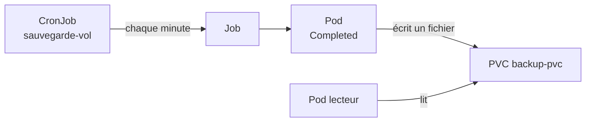

### Étape 1 : Préparer le namespace

```bash
k create namespace tp-k8s
k config set-context --current --namespace=tp-k8s
```

> **Résultat** : le namespace `tp-k8s` est créé et sélectionné par défaut.

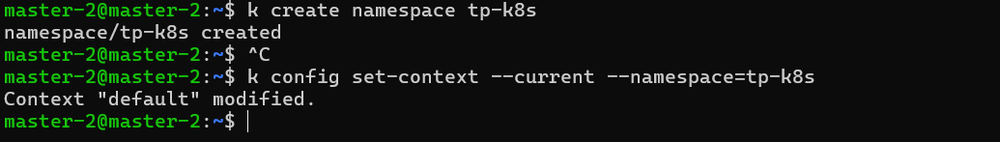

---

### Étape 2 : Un Job simple

```bash
k apply -f lab6.1/yaml/calcul.yaml
k wait --for=condition=complete job/calcul --timeout=60s
k get job,pods
k logs job/calcul
k describe job calcul | grep -E "Pods Statuses|Completions"
```

> **Résultat** : le Job `calcul` affiche `COMPLETIONS 1/1`, son Pod est `Completed` et n'a pas été relancé, et `k logs` affiche `debut` puis `fin`.

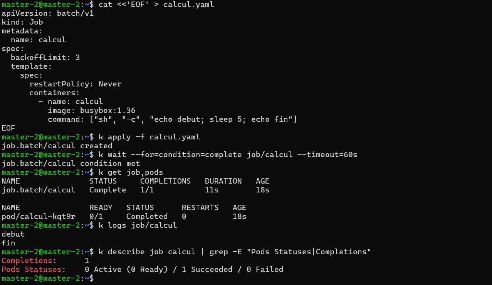

---

### Étape 3 : Un Job en échec

Un Job dont le conteneur termine toujours en erreur est relancé jusqu'à `backoffLimit`.

```bash
k apply -f lab6.1/yaml/echec.yaml
k get pods -l job-name=echec -w

k get job echec
k describe job echec | tail -n 8
k logs -l job-name=echec

# Comparaison avec restartPolicy: OnFailure
sed -e 's/name: echec/name: echec-onfailure/' -e 's/restartPolicy: Never/restartPolicy: OnFailure/' lab6.1/yaml/echec.yaml | k apply -f -
sleep 40
k get pods -l job-name=echec-onfailure
```

| `restartPolicy` | Comportement observé |
|-----------------|----------------------|
| `Never` | Chaque tentative crée un **nouveau Pod** : trois Pods distincts en `Error` avant l'échec du Job |
| `OnFailure` | Le conteneur est relancé **dans le même Pod** : un seul Pod, avec une colonne `RESTARTS` qui augmente |

> **Résultat** : avec `Never`, trois Pods en erreur sont créés, et `describe` mentionne `BackoffLimitExceeded`. Les tentatives s'espacent (environ 10 s, puis 20 s).

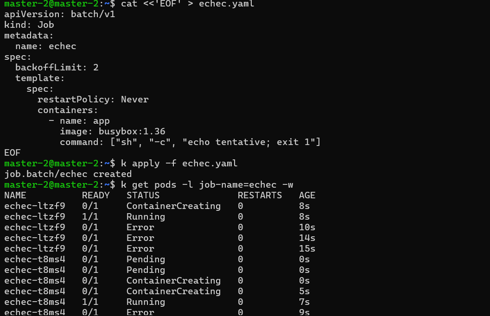

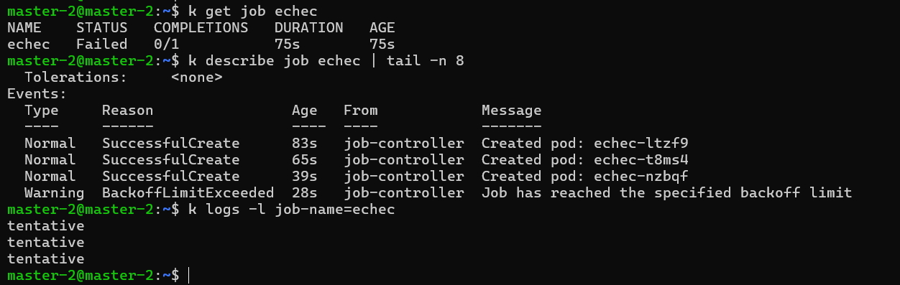

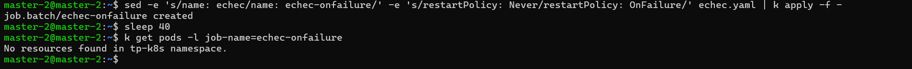

---

### Étape 4 : Un Job parallèle avec nettoyage automatique

Ce Job doit réussir 6 tâches, 2 à la fois, et se supprime tout seul 2 minutes après sa fin (`ttlSecondsAfterFinished: 120`).

```bash
# Terminal 2
k get pods -l job-name=parallele -w

# Terminal 1
k apply -f lab6.1/yaml/parallele.yaml
k get job parallele -w
```

> **Résultat** : jamais plus de deux Pods ne tournent simultanément, et le Job atteint `COMPLETIONS 6/6`.

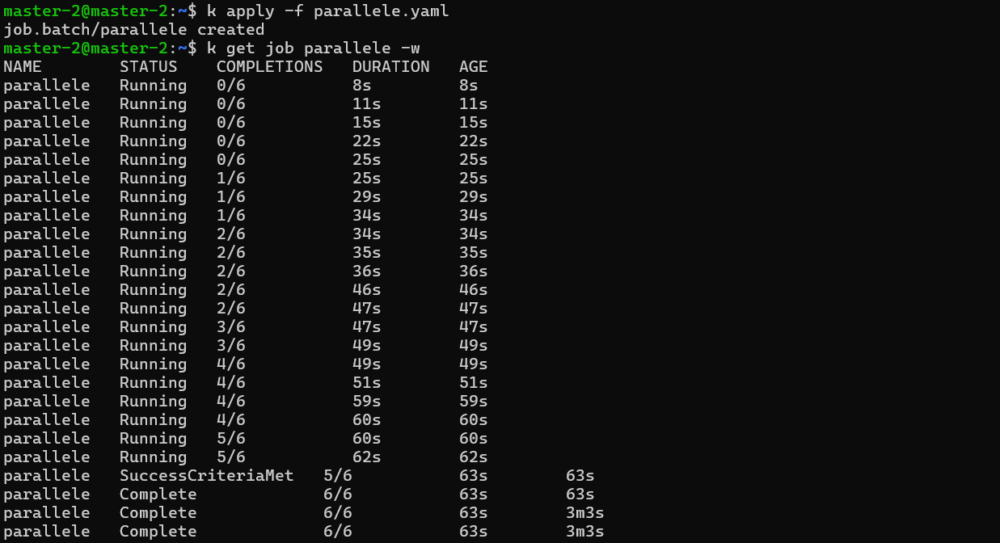

---

### Étape 5 : Un CronJob

```bash
k apply -f lab6.1/yaml/sauvegarde.yaml
k get cronjob

# Déclenchement immédiat d'un Job de test
k create job --from=cronjob/sauvegarde test-manuel
k wait --for=condition=complete job/test-manuel --timeout=60s
k logs job/test-manuel

# Après environ 2 minutes
k get cronjob
k get jobs
JOB=$(k get jobs --sort-by=.metadata.creationTimestamp -o name | tail -n 1)
k logs $JOB
k get jobs        # le Job parallele a été supprimé automatiquement
```

> **Résultat** : le Job `test-manuel` s'exécute immédiatement, sans attendre l'échéance. Un nouveau Job `sauvegarde-<nombre>` apparaît ensuite chaque minute, la colonne `LAST SCHEDULE` est renseignée, et le Job `parallele` n'existe plus (TTL écoulé).

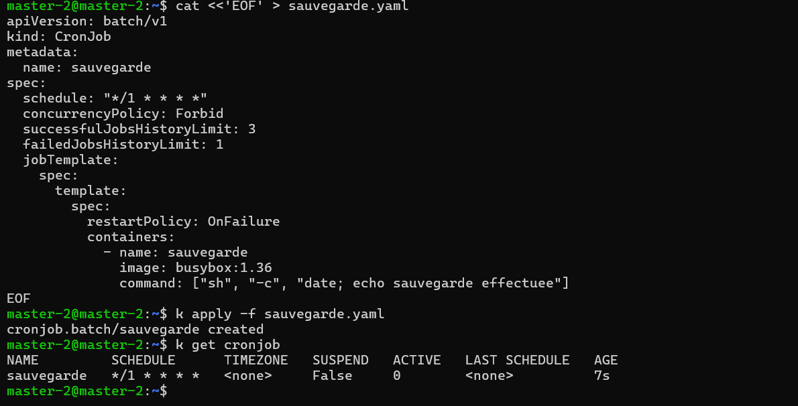

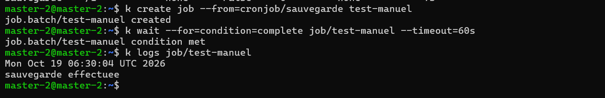

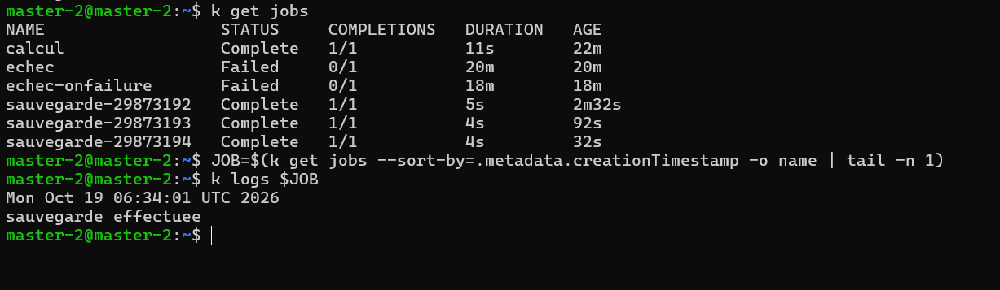

---

### Étape 6 : Concurrence et suspension

Le CronJob `lent` s'exécute 150 s alors que son intervalle est d'une minute, avec `concurrencyPolicy: Forbid`.

```bash
k apply -f lab6.1/yaml/lent.yaml
sleep 150
k get jobs | grep lent
k describe cronjob lent | tail -n 6

k delete cronjob lent
k patch cronjob sauvegarde -p '{"spec":{"suspend":true}}'
k get cronjob
k get jobs
sleep 90
k get jobs

k patch cronjob sauvegarde -p '{"spec":{"suspend":false}}'
k get cronjob
```

> **Résultat** : un seul Job `lent-...` est actif malgré plusieurs échéances (les suivantes sont ignorées, et les événements indiquent qu'une exécution est déjà en cours). Pendant la suspension, aucun nouveau Job n'est créé. Après la reprise, `k get cronjob` affiche `SUSPEND False`.

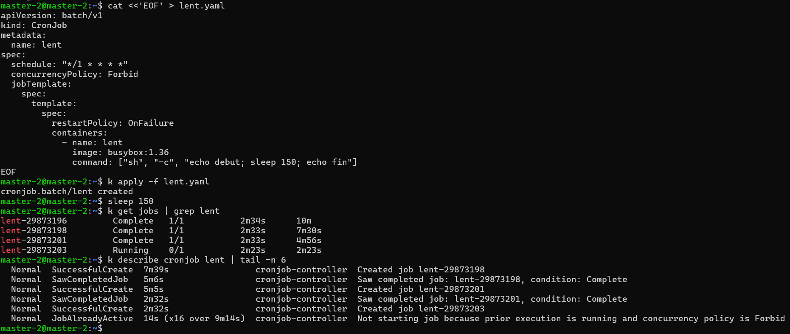

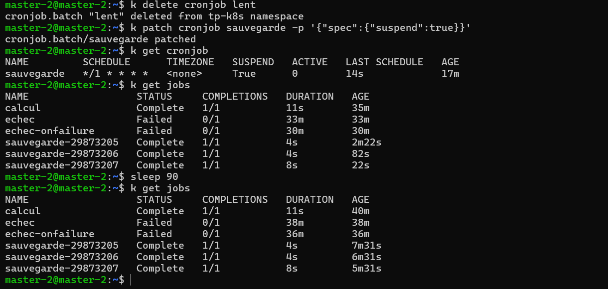

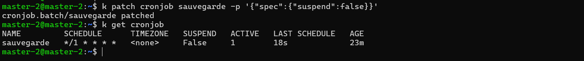

---

### Étape 7 : Sauvegarde sur un volume persistant

```bash
k delete cronjob sauvegarde
k apply -f lab6.1/yaml/sauvegarde-vol.yaml
k get pvc                                       # Pending jusqu'à la première exécution

# Après environ 3 minutes
k get jobs
k get pvc
k apply -f lab6.1/yaml/lecteur.yaml
k wait --for=condition=Ready pod/lecteur --timeout=60s
k exec lecteur -- ls -l /backup
k exec lecteur -- sh -c 'cat /backup/$(ls /backup | tail -n 1)'
```

> **Résultat** : le PVC `backup-pvc` est d'abord `Pending` (volume créé au premier consommateur), puis `Bound`. Des fichiers `dump-...txt` s'accumulent dans `/backup`, un par exécution, et ils sont lisibles depuis le Pod `lecteur`, distinct des Pods de sauvegarde.

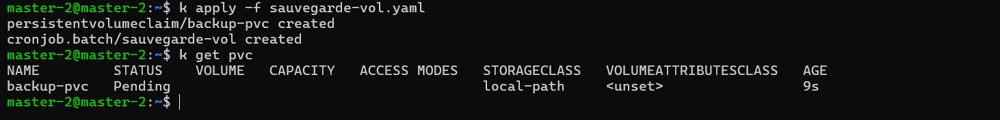

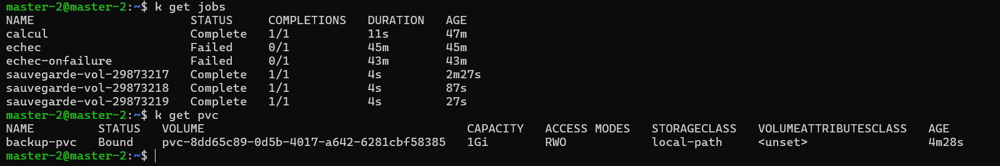

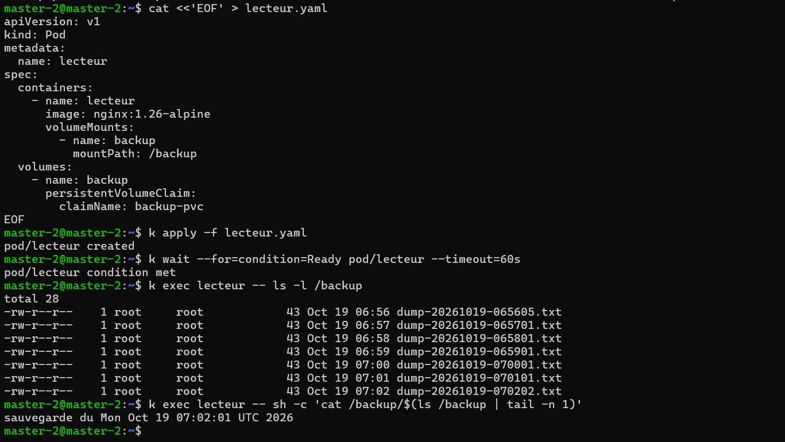

---

### Nettoyage

```bash
k delete namespace tp-k8s
k config set-context --current --namespace=default
k get pv
```

La suppression du namespace supprime les CronJobs, les Jobs, les Pods et le PVC. `k get pv` ne doit plus lister de volume de ce lab.

### Questions de réflexion (Lab 6.1)

<details>
<summary><strong>1. Quelle différence de comportement entre restartPolicy: Never et OnFailure pour un Job qui échoue ?</strong></summary>

Avec `Never`, chaque tentative crée un **nouveau Pod** (les Pods en erreur restent visibles). Avec `OnFailure`, le conteneur est relancé **dans le même Pod** (la colonne `RESTARTS` augmente).
</details>

<details>
<summary><strong>2. À quoi sert ttlSecondsAfterFinished ?</strong></summary>

À supprimer automatiquement un Job terminé et ses Pods après un délai. Sans lui, les Jobs et leurs Pods s'accumulent dans le namespace.
</details>

<details>
<summary><strong>3. Que se passerait-il avec concurrencyPolicy: Allow dans l'étape 6 ?</strong></summary>

Une nouvelle exécution démarrerait à chaque minute sans attendre la fin de la précédente : plusieurs Jobs `lent-...` tourneraient en parallèle, ce qui est dangereux pour une sauvegarde.
</details>

<details>
<summary><strong>4. Pourquoi kubectl create job --from=cronjob/... est-il utile ?</strong></summary>

Il permet de tester immédiatement le contenu du CronJob (commande, volumes, variables) sans attendre l'échéance du calendrier.
</details>

<details>
<summary><strong>5. Une sauvegarde stockée sur le même volume local que la base protège-t-elle contre la perte d'un nœud ? Que proposeriez-vous ?</strong></summary>

Non : si le nœud tombe, la base et sa sauvegarde disparaissent ensemble. Il faut copier les sauvegardes ailleurs : stockage réseau, autre nœud, stockage objet ou machine distante.
</details>

### Dépannage (Lab 6.1)

| Symptôme | Pistes |
|----------|--------|
| Job qui ne démarre pas | `k describe job` et `k describe pod` : image, ressources, quota |
| Pod du Job en `Error` | `k logs <pod>` : lire le message de la commande |
| Aucun Job créé par le CronJob | Vérifier `schedule` (cinq champs), `SUSPEND`, l'heure du cluster (UTC) ; patienter jusqu'à la minute suivante |
| `LAST SCHEDULE` vide | Aucune échéance n'a encore eu lieu : attendre une minute |
| Jobs qui s'accumulent | Régler `successfulJobsHistoryLimit`, `failedJobsHistoryLimit` ou `ttlSecondsAfterFinished` |
| `create job --from` : not found | Nom du CronJob incorrect ou mauvais namespace : `k get cronjob` |
| PVC `backup-pvc` en `Pending` | Normal avant la première exécution ; ensuite `k describe pvc backup-pvc` |
| Pod `lecteur` en `Pending` | PVC non lié, ou nœud du volume indisponible : `k describe pod lecteur` |
| Dossier `/backup` vide | Attendre l'exécution suivante ; vérifier `k get jobs` et `k logs job/<nom>` |


---

## Auteur

| | |
|---|---|
| **Nom** | Dabbech |
| **Prénom** | Narjess |
| **Classe** | M2 DevOps |
| **GitHub** | [@Narjess805](https://github.com/Narjess805) |
| **Date** | Octobre 2026 |
