<div align="center">

# Lab 6.2 : Patterns multi-conteneurs

Init containers, sidecar, réseau partagé et ambassador


</div>

---

> Cette branche contient uniquement le **Lab 6.2**. L'autre partie est sur la branche [`lab6.1`](https://github.com/Narjess805/lab6-jobs-patterns/tree/lab6.1), et la vue d'ensemble sur [`main`](https://github.com/Narjess805/lab6-jobs-patterns/tree/main).

---

## Environnement de travail

| Composant | Détails |
|-----------|---------|
| Cluster | K3s, 3 nœuds `Ready` (1 master + 2 workers) |
| StorageClass | `local-path` (par défaut) |
| Images utilisées | `busybox:1.36`, `nginx:1.26-alpine` |
| Namespace | `tp-k8s` |
| Alias | `k` pour `kubectl` |

| Nœud | Rôle | Adresse IP |
|------|------|------------|
| Master | control-plane | `192.168.56.20` |
| Worker 1 | worker | `192.168.56.31` |
| Worker 2 | worker | `192.168.56.32` |

---

## Étapes réalisées et résultats

Trois Pods à plusieurs conteneurs, chacun illustrant un pattern du cours : **init containers**, **sidecar** et **ambassador**.

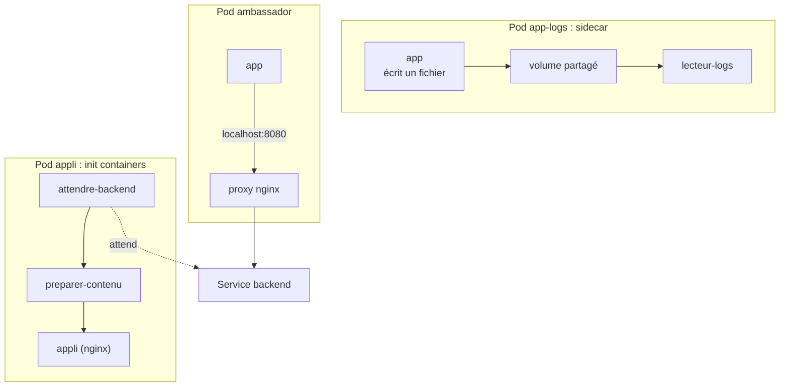

| Pattern | Pod | Principe |
|---------|-----|----------|
| **Init containers** | `appli` | Attendre une dépendance et préparer des fichiers avant le démarrage de l'application |
| **Sidecar** | `app-logs` | Un second conteneur relit un fichier partagé et l'affiche sur sa sortie standard |
| **Ambassador** | `ambassador` | Un proxy local masque l'adresse réelle d'un service distant |

### Étape 1 : Préparer le namespace

```bash
k create namespace tp-k8s
k config set-context --current --namespace=tp-k8s
```

> **Résultat** : le namespace `tp-k8s` est créé et sélectionné par défaut.

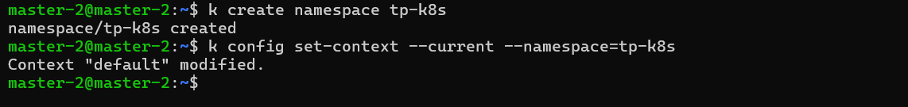

---

### Étape 2 : Init containers

Le Pod `appli` démarre deux init containers, dans l'ordre : `attendre-backend` boucle tant que le Service `backend` n'est pas joignable, puis `preparer-contenu` écrit une page dans un volume partagé avec nginx. Le Service `backend` n'existe pas encore : l'initialisation reste bloquée.

```bash
k apply -f lab6.2/yaml/appli.yaml
sleep 15
k get pods
k logs deploy/appli -c attendre-backend --tail=3

# Création du backend (terminal 2 : k get pods -w)
k apply -f lab6.2/yaml/backend.yaml

k logs deploy/appli -c attendre-backend --tail=2
k exec deploy/appli -c appli -- wget -qO- http://localhost
```

> **Résultat** : tant que le backend n'existe pas, le Pod reste en `Init:0/2` et les logs de `attendre-backend` montrent les tentatives. Après la création du backend, le Pod passe par `Init:1/2` et `PodInitializing` jusqu'à `Running`, puis les logs indiquent `backend disponible`. nginx sert la page écrite par `preparer-contenu`.

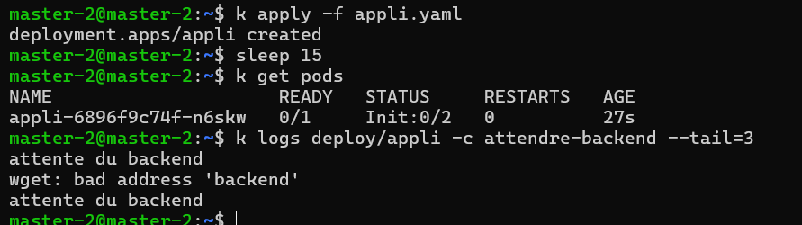

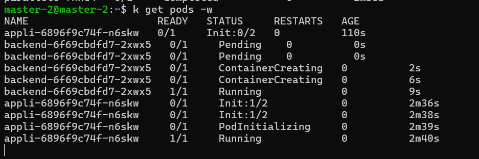

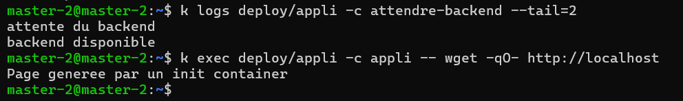

---

### Étape 3 : Diagnostiquer un init container en échec

```bash
k apply -f lab6.2/yaml/init-erreur.yaml
sleep 30
k get pod init-erreur
k logs init-erreur -c init-casse
k describe pod init-erreur | grep -A8 "Init Containers"
k delete pod init-erreur
```

> **Résultat** : le statut commence par `Init:` (`Init:Error` puis `Init:CrashLoopBackOff`). Les logs de l'init container affichent `preparation en cours`, et `describe` donne le code de sortie. Les conteneurs de l'application ne démarrent jamais tant que l'init container échoue.

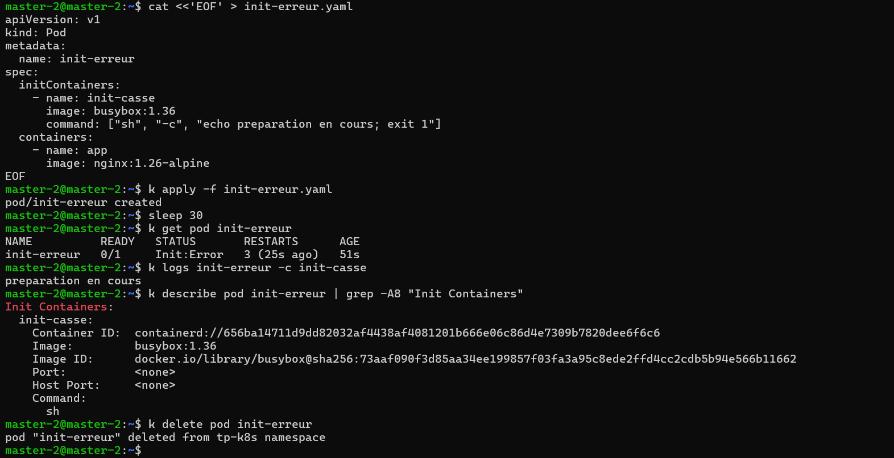

---

### Étape 4 : Sidecar, volume partagé et réseau partagé

Un conteneur `app` écrit ses logs dans un fichier, et un sidecar `lecteur-logs` les relit pour les rendre visibles avec `kubectl logs`.

```bash
k apply -f lab6.2/yaml/app-logs.yaml
k wait --for=condition=Ready pod/app-logs --timeout=60s
sleep 15
k get pod app-logs
k logs app-logs -c app
k logs app-logs -c lecteur-logs --tail=3
k exec app-logs -c app -- ls -l /logs
```

> **Résultat** : le Pod affiche `READY 2/2`. Les logs du conteneur `app` sont **vides** (il écrit dans un fichier, pas sur la sortie standard), alors que ceux de `lecteur-logs` montrent les dates du fichier.

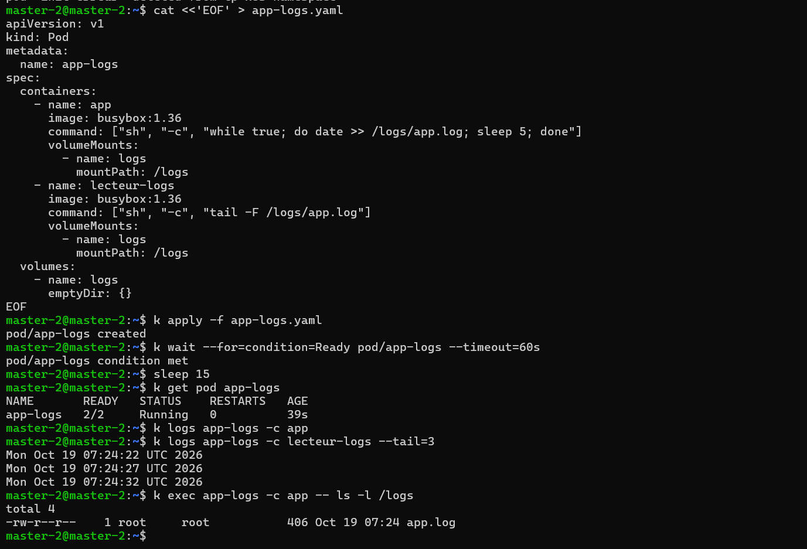

Les conteneurs d'un Pod partagent aussi le **réseau** : un second conteneur joint le premier avec `localhost`.

```bash
k apply -f lab6.2/yaml/reseau-partage.yaml
k wait --for=condition=Ready pod/reseau-partage --timeout=60s
sleep 15
k logs reseau-partage -c testeur --tail=2
```

> **Résultat** : le conteneur `testeur` obtient la page de nginx via `localhost`.

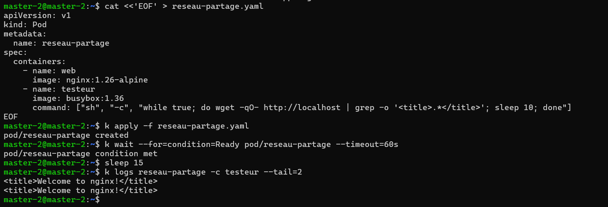

---

### Étape 5 : Ambassador

L'application appelle uniquement `localhost:8080` ; un conteneur nginx joue le rôle de proxy vers le Service `backend`. L'application ignore l'adresse réelle du service distant.

```bash
k apply -f lab6.2/yaml/ambassador.yaml
k wait --for=condition=Ready pod/ambassador --timeout=60s
sleep 15
k logs ambassador -c app --tail=3

# Coupure puis rétablissement du backend
k scale deployment backend --replicas=0
sleep 15
k logs ambassador -c app --tail=3
k scale deployment backend --replicas=1
k rollout status deployment/backend
sleep 15
k logs ambassador -c app --tail=3
```

| Situation du backend | Ce que voit l'application |
|----------------------|---------------------------|
| 1 réplica | La page du backend, en appelant seulement `localhost:8080` |
| 0 réplica | Une erreur (passerelle ou connexion refusée) |
| Rétabli à 1 réplica | De nouveau la page, **sans modification ni redémarrage** de l'application |

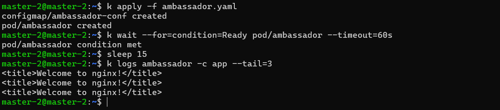

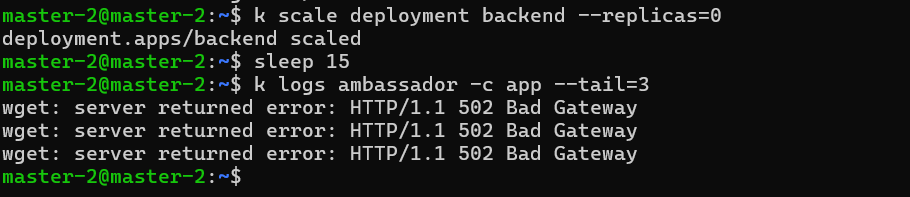

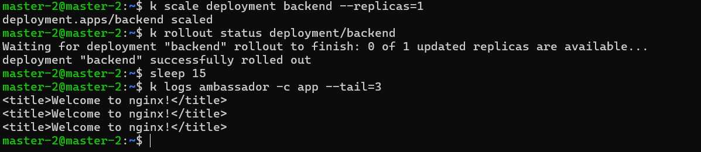

---

### Nettoyage

```bash
k delete namespace tp-k8s
k config set-context --current --namespace=default
```

> **Résultat** : l'environnement est nettoyé, et aucun PV ne subsiste.

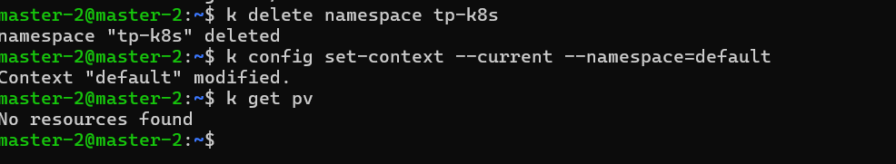

### Questions de réflexion (Lab 6.2)

<details>
<summary><strong>1. Pourquoi un init container est-il préférable à une boucle d'attente écrite dans l'application ?</strong></summary>

Il sépare la préparation de l'application, qui reste simple, et garantit que les conteneurs applicatifs ne démarrent qu'une fois la dépendance disponible. Il se diagnostique à part, avec `logs -c`.
</details>

<details>
<summary><strong>2. Que se passe-t-il si un init container échoue de façon répétée ?</strong></summary>

Les conteneurs de l'application ne démarrent pas. Le Pod reste en `Init:Error` puis `Init:CrashLoopBackOff`, avec des redémarrages de plus en plus espacés.
</details>

<details>
<summary><strong>3. Pourquoi les logs du conteneur app de l'étape 4 sont-ils vides alors que l'application fonctionne ?</strong></summary>

Elle écrit dans un fichier et non sur la sortie standard, seule source de `kubectl logs`. Le sidecar relit le fichier et l'affiche sur sa propre sortie standard.
</details>

<details>
<summary><strong>4. Qu'est-ce qui permet à testeur d'appeler nginx avec localhost ?</strong></summary>

Les conteneurs d'un même Pod partagent la même interface réseau et la même adresse IP, donc `localhost` désigne le même Pod.
</details>

<details>
<summary><strong>5. Quel intérêt d'un ambassador pour l'application ?</strong></summary>

Elle appelle toujours `localhost`, quelle que soit la destination réelle. Le proxy peut changer d'adresse, ajouter de la sécurité ou de la reprise sur erreur sans toucher au code de l'application.
</details>

### Dépannage (Lab 6.2)

| Symptôme | Pistes |
|----------|--------|
| Pod bloqué en `Init:0/2` | `k logs <pod> -c attendre-backend` : le Service `backend` existe-t-il, a-t-il des endpoints (`k get endpoints backend`) ? |
| `Init:CrashLoopBackOff` | `k logs <pod> -c <init>` et `k describe pod` : commande ou code de sortie |
| `a container name must be specified` | Pod à plusieurs conteneurs : ajouter `-c <conteneur>` (la liste est indiquée dans le message) |
| `READY 1/2` | L'un des conteneurs a échoué : `k describe pod`, section Containers |
| Logs du sidecar vides | Attendre quelques secondes ; vérifier que les deux conteneurs montent le même volume au même chemin |
| `testeur` n'affiche rien | nginx démarre encore : attendre 10 à 15 secondes puis relire les logs |
| L'ambassador ne répond pas | Nom du Service `backend` ou port incorrect dans `proxy_pass` ; contrôler `k get endpoints backend` |
| Configuration de l'ambassador non prise en compte | Un montage `subPath` n'est pas rafraîchi : recréer le Pod |


---

## Auteur

| | |
|---|---|
| **Nom** | Dabbech |
| **Prénom** | Narjess |
| **Classe** | M2 DevOps |
| **GitHub** | [@Narjess805](https://github.com/Narjess805) |
| **Date** | Octobre 2026 |
